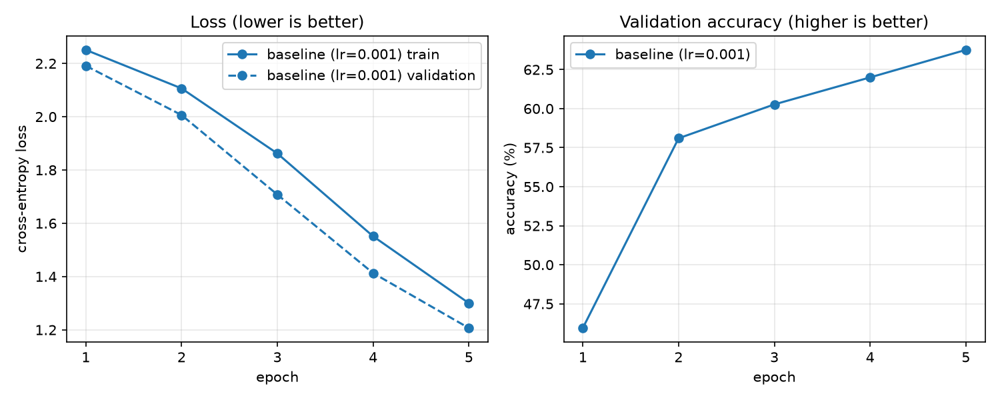

# ml-foundations

My first PyTorch training project. A small neural network learns to classify
FashionMNIST clothing images, and I use it to learn the training loop from the inside:
predictions, loss, gradients, weight updates, and controlled experiments. It is a
warm-up for robot learning and evaluation work.

Status: in progress, started 2026-10-18.

## Contents

| file | purpose |
|---|---|
| `train.py` | trains the network and saves a record of the run to `runs/<name>.json` |
| `model.py` | the network: 784 pixels -> 512 -> 512 -> 10 class scores |
| `plot.py` | plots every run in `runs/` on the same axes and saves `runs/compare.png` |
| `exercise1_weight_update.py` | follows one weight through one SGD step |
| `NOTEBOOK.md` | lab notebook: predictions, results and interpretation, in order |

## Run it

Requires [uv](https://docs.astral.sh/uv/). The first run downloads FashionMNIST
(about 30 MB compressed) into `data/`.

```bash
uv run train.py --name baseline
uv run plot.py
```

## Data

[FashionMNIST](https://github.com/zalandoresearch/fashion-mnist) has 70,000 28x28
grayscale images in 10 classes: T-shirt/top, trouser, pullover, dress, coat, sandal,
shirt, sneaker, bag and ankle boot.

- **Train (50,000)** and **validation (10,000)** are split from the official 60,000
  training images with a fixed seed. Runs are compared on validation.
- **Test (10,000)** is the official test set. It is scored once, at the end, with
  `--test`, so that choosing settings never depends on it.

## Reproducibility

Runs use a fixed seed on CPU. The same command run twice gives identical numbers.

## Results so far

| run | change from baseline | final val accuracy | final val loss |
|---|---|---:|---:|
| baseline | none (Quickstart settings, lr 1e-3, 5 epochs) | 63.8% | 1.207 |



## What I tested, what happened, what remains uncertain

To be written after the learning-rate comparison.

## Credits

The network and training loop follow the
[PyTorch Quickstart](https://docs.pytorch.org/tutorials/beginner/basics/quickstart_tutorial.html).
